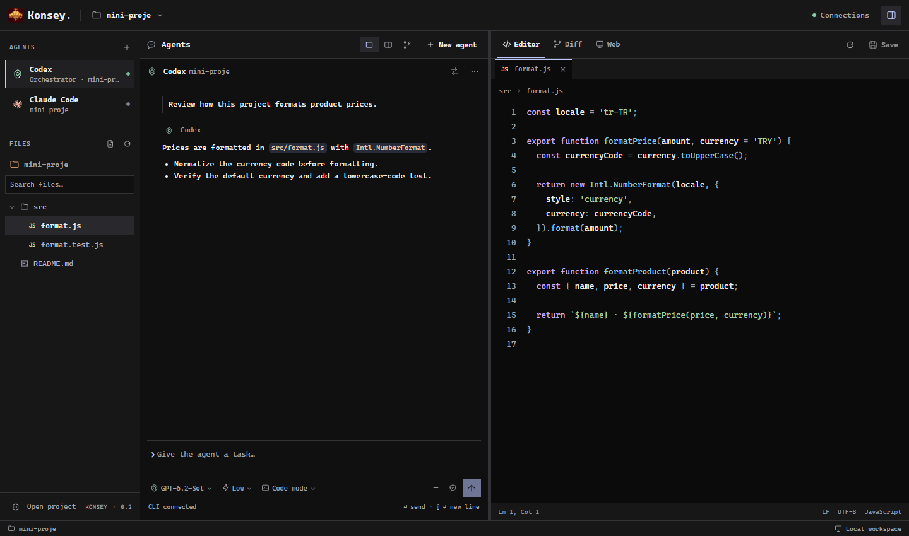
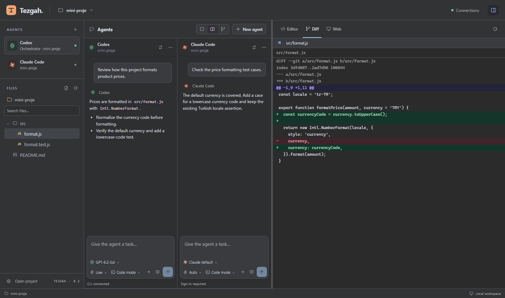
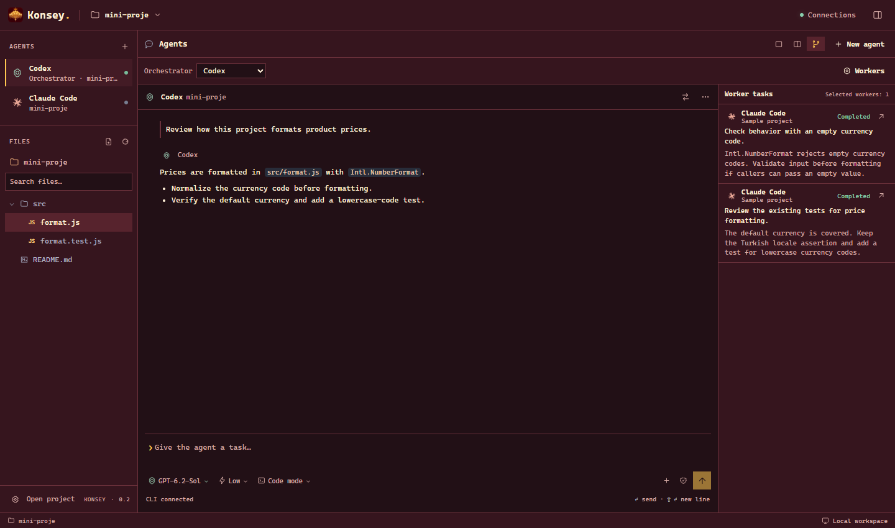

# Konsey

Konsey is a Windows desktop workspace for Codex, Claude Code, and Google Antigravity. Run agents side by side, edit their projects, review Git changes, and preview a running web app in the same window.



## What you can do

- Split the workspace into up to eight agent panels. Agents can work in the same folder or in different projects. Review a reply before handing it off to another agent, and queue the handoff if the target agent is busy.
- Choose a project folder in the top bar to open its own agents, chats, drafts, and Orchestrator team. Switching projects stops active turns and archives that workspace. Select the project again to restore it. Use **Edit agent → Working folder** if a member of the team needs to work in a different folder.
- Open **Orchestrator**, choose a lead agent and its workers, then send the lead a task. The lead can delegate independent work across the selected agents. See tasks and results in **Worker tasks**, and approve or decline requests in that panel.
- Use one model picker for all three providers. Konsey remembers reasoning effort, work mode, approval preferences, and tool settings per model. Claude Code also exposes Ultracode for supported models.
- Type `/` in the composer for shortcuts such as `/model`, `/effort`, `/plan`, `/permissions`, and `/orchestrator`. On supported Codex and Claude Code models, use the speed button or `/fast` to toggle Fast Mode. Use `/fast on` and `/fast off` to set it explicitly. Fast Mode can affect provider usage and billing.
- Browse and search project files, edit code, and compare saved changes in the **Diff** panel. Open a running HTTP or HTTPS address, such as `http://localhost:3000`, in the **Web** panel.
- Use the composer’s **+** menu to add file or folder context, attach a sketch, set a goal, or enable browser and Windows computer tools. Konsey asks before performing each browser or computer action.
- Switch between **Terminal** and **Classic** in **Settings**. Each layout remembers its palette. Choose **Konsey** for a dark red palette with yellow accents. Other options include True Dark, Darcula, [Dracula](https://draculatheme.com/spec), and [Nord](https://www.nordtheme.com/docs/colors-and-palettes/). English is the default interface language. Select **Türkçe** to switch to Turkish.





The screenshots show the bundled sample project and example conversations.

## Run locally

Install **Node.js 22.12 or later** and **Git** on Windows. Clone the repository and run these commands:

```powershell
npm ci
npm start
```

Konsey uses the provider CLI installed on your machine and its existing login session. Sign in to the providers you use.

| Provider | Sign-in command |
| --- | --- |
| [Codex](https://learn.chatgpt.com/docs/app-server) | `codex login` |
| [Claude Code](https://code.claude.com/docs/en/cli-reference) | `claude auth login` |
| [Google Antigravity](https://antigravity.google/docs/ide/extensions/acp/) | `agy` |

Check **Connections** to see which CLIs Konsey can reach. Available models, reasoning levels, and automatic approval options depend on the provider and your account.

For **Attach Google Chrome**, open `chrome://inspect/#remote-debugging` in Chrome, allow remote debugging, and select a tab in Konsey. Konsey also has a separate browser window for agent tools. Windows computer use operates on the primary display.

## Development

- `npm run check` checks JavaScript syntax.
- `node --test example/src/format.test.js` runs the sample project’s tests.
- `npm run serve` starts the browser-based development interface. Desktop tools and the embedded preview use the Electron app.
- `npm run dist:win` builds an unsigned Windows x64 installer in `dist/`.

Konsey stores workspace settings, project paths, and chats in `%LOCALAPPDATA%\Konsey` on new installations. Existing Tezgah and Eksen workspaces continue to use their current folders.
